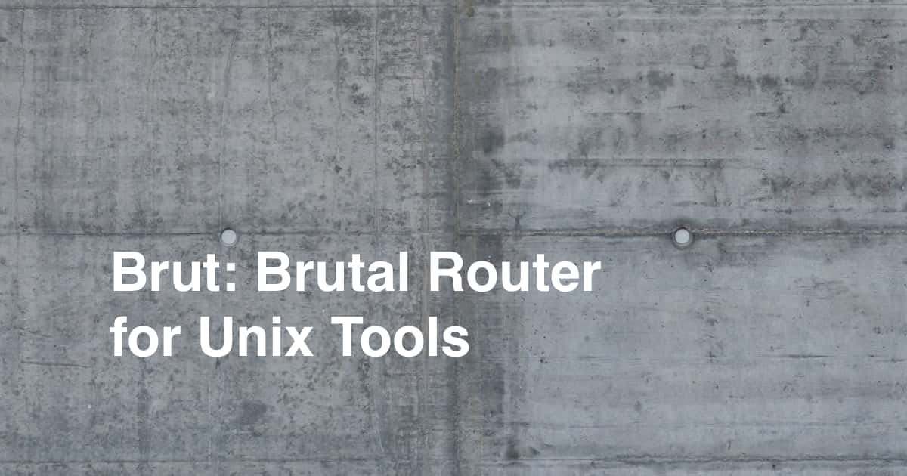

# 

This is the source code repository for Brat, the _Router for Unix Tools_, a single-file POSIX shell script for building Unix command-line programs.

Brat serves as the front-end executable for your program, dispatching (or “routing”) to a collection of commands based on the first argument passed to it, a style popularized by the Git CLI.

    $ myprog build ‑‑release
        ↓ your shell finds myprog (Brat) somewhere in your PATH
      bin/myprog build ‑‑release
        ↓ Brat extends PATH, finds myprog‑build, and runs it
      libexec/myprog‑build ‑‑release

The [annotated source code](https://github.com/amadv/brat) is Brat’s complete manual, covering commands, shared scripts, error handling, hooks, and namespaces. It is generated automatically from literate documentation comments in the [`brat.sh`](brat.sh) file.

Brat is feature-complete. It targets the [POSIX.1-2024 specification](https://pubs.opengroup.org/onlinepubs/9799919799/utilities/contents.html) and is intended to work unmodified for years to come.

## Building and Testing

Brat’s internal build tool is a Brat program called `x`. This program lives in the [`support/`](support/) directory.

Run `./x build` to build the static web site into `dist/`.

Run `./x preview` to build the annotated source for the working copy into `dist/preview/` and open it in a browser.

Run `./x test` to run the [test suite](test/) against the distributable script built from the working copy. The tests run with a bundled copy of [Brat](https://github.com/amadv/brat). (To test another version of Brat, set `BRAT` to the path to that version.)

Run `./x watch` to rebuild the preview and rerun the test suite as you edit. The preview opens in a browser automatically in response to documentation or web site changes.

Run `./x clean` to clean the build output.

### Dependencies

Brat itself requires only a POSIX shell and several of the standard POSIX utilities. Specifically, Brat depends on awk, find, realpath, sh, sort, and tr.

To build Brat, you will need Git, make, Pandoc, and sha256sum. `./x watch` requires fswatch, and `./x preview` requires xdg-open on systems other than macOS.

### Continuous Integration

We test Brat with continuous integration on the following platforms:

| | sh | awk |
|---|---|---|
| Alpine Linux | busybox ash | busybox awk |
| Debian Linux | dash | mawk |
| Fedora Linux | Bash | gawk |
| FreeBSD | FreeBSD ash | nawk |
| macOS | Bash (3.2) | nawk |

## Versioning and Distribution

Brat versions are content-addressed. Each version number is derived from the SHA-256 digest of the source code with comments and empty lines removed.

Every version of Brat has a permanent URL, `https://github.com/amadv/brat/<VERSION>`, that contains the annotated source code and a distributable script.

Visitors to [https://github.com/amadv/brat](https://github.com/amadv/brat) will be redirected to the newest version.

## Contributing

The Brat repository is [hosted on GitHub](https://github.com/amadv/brat).

Because Brat is feature-complete, we do not accept pull requests to add new functionality. However, we welcome human-written bug reports and improvements to the literate documentation.

## License

Brat is freely distributable under the terms of the maximally permissive MIT-0 license, included at the top of `brat.sh` and in [LICENSE.md](LICENSE.md).

---

© 2026 [Aaron Madved](https://github.com/amadv). Handwritten in Mexico City.

<small>UNIX® is a registered trademark of The Open Group. 
POSIX™ is a trademark of IEEE. </small>
